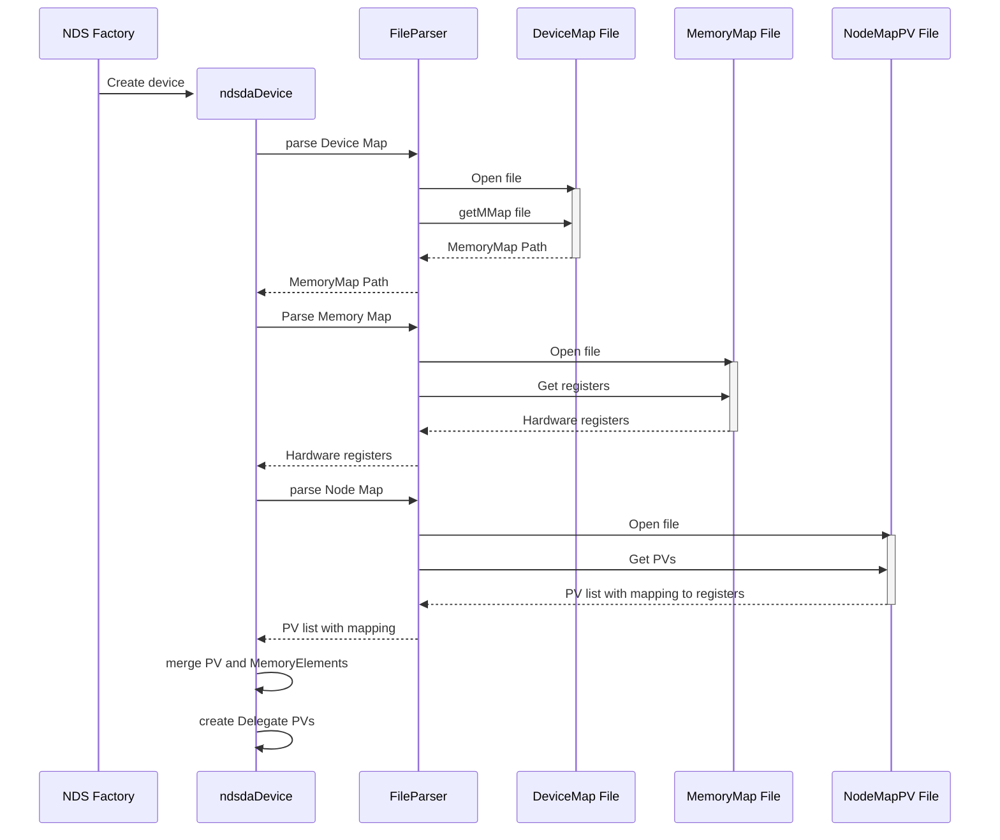
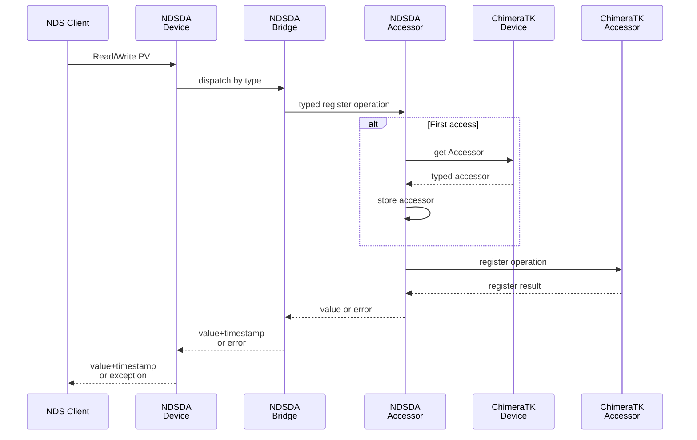

# NDS-DeviceAccess

Nominal Device Support compatibility layer for integration of ChimeraTK DeviceAccess. Provides automatic PV generation and read-write access to the device registers.

> [!IMPORTANT]
> This project requires a C++20-capable toolchain. The build system enforces C++20 through CMake (`CMAKE_CXX_STANDARD 20`), therefore compilers without complete C++20 support are not compatible.

Documentation is available at [GitLab Pages](https://pages.i2a2.upm.es/iter/nds/nds-deviceaccess).

## Build and install

### Prerequisites

The following external libraries are required:

- [NDS3](https://git.i2a2.upm.es/iter/nds/nds-core)
- [ChimeraTK DeviceAccess](https://github.com/ChimeraTK/DeviceAccess)

The project uses CMake and a C++20 compiler.

### Configure and build

The recommended flow is out-of-source CMake generation using explicit source and build directories:

```bash
cmake -S . -B build -DCMAKE_BUILD_TYPE=Release -DCMAKE_INSTALL_PREFIX=/usr/local
cmake --build build --target all -- -j"$(nproc)"
```

### Package and install

The project is configured to produce an RPM package via CPack:

```bash
cmake --build build --target package
```

Install the generated package:

```bash
sudo dnf install build/<package-name>.rpm
```

### Unit Testing

The CI workflow runs tests and coverage in Debug mode with coverage instrumentation enabled. The equivalent local sequence is:

```bash
cmake -S . -B build -DCMAKE_BUILD_TYPE=Debug -DENABLE_COVERAGE=ON
cmake --build build --target all
ctest --test-dir build --output-on-failure --output-junit tests.xml
cmake --build build --target coverage
```

Coverage artifacts are generated under `build/coverage`, including:

- `build/coverage/details/coverage.html` (detailed HTML report)
- `build/coverage/nested/coverage.html` (nested HTML report)
- `build/coverage/coverage.xml` (Cobertura XML report)

For quick validation without coverage, a standard test execution is:

```bash
ctest --test-dir build --output-on-failure
```

## Driver implementation quick start

Driver implementation is based on inheritance from `ndsda::ndsdaDevice`. The base class parses configuration files, resolves map relations, creates PV delegates, and wires register access logic automatically.

Required named parameters passed to the base constructor:

- `DeviceAlias`: alias to locate the target device in the `.dmap` file.
- `DeviceMapFile`: path to the `.dmap` file.
- `NodeMapFile`: path to the node map XML.

Minimal structure:

```cpp
#include "ndsdaDevice.hpp"

class Device : public ndsda::ndsdaDevice {
public:
    Device(nds::Factory& factory,
           const std::string& deviceName,
           const nds::namedParameters_t& params)
        : ndsda::ndsdaDevice(factory, deviceName, params) {

        // Optional: add custom PVs or nodes here.

        rootNode.initialize(this, factory);
    }
};
```

Example implementation in [nds-tmpe](https://git.i2a2.upm.es/iter/nds/nds-tmpe).

## Implementation summary

The library is organized in three explicit layers with clear ownership and error-propagation responsibilities.

### 1. `ndsdaDevice` (NDS-facing layer)

This layer owns the device lifecycle from the NDS perspective. Its responsibilities are:

- Read and validate required configuration parameters.
- Resolve the memory map from the device map alias.
- Parse node map and memory map inputs.
- Create and register NDS PV delegates (`PVDelegateIn`/`PVDelegateOut`) for each mapped PV. The delegate lambdas call into the `DABridge` for type-specific dispatch.
- Expose informational PVs (`deviceAlias`, `deviceMapFile`, `memoryMapFile`, `nodeMapFile`).

Interaction with NDS is concentrated here through `nds::Port` and delegate registration.

### 2. `DABridge` (conversion and dispatch layer)

This layer converts between NDS-side PV abstractions and DeviceAccess register operations. Its responsibilities are:

- Runtime dispatch based on `PVTypeEnum`.
- Scalar and 1D path selection.
- Type-specific conversions (for example, `std::string` and `std::vector<bool>` handling).
- Timestamp generation for read operations.

This layer isolates protocol/type adaptation so that `ndsdaDevice` remains focused on orchestration.

### 3. `DAAccessor` (DeviceAccess access layer)

This is the low-level hardware-access abstraction over `ChimeraTK::Device`. Its responsibilities are:

- Open/close device access sessions.
- Read/write scalar registers.
- Read/write one-dimensional registers.
- Cache typed ChimeraTK accessors in register metadata objects for reuse.

Interaction with ChimeraTK DeviceAccess is concentrated in this layer.

### Error and result management (`Result<>` and `std::optional<>`)

The implementation uses two complementary conventions:

- `Result<T>` (`boost::outcome`) for operations that return either a value or an error.
- `std::optional<ndsdaError>` for operations where success has no payload and only failure must be reported.

The operations inside the driver use these formats, while throwing the errors as exceptions at the NDS-facing layer (`ndsdaDevice`) to maintain their expected behavior.

### Operational sequence

#### Device initialization



#### Read/Write PV operation


